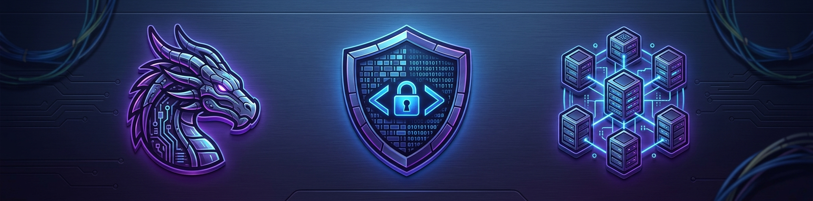

  

  <strong>Web Developer & Cybersecurity Specialist | Software & Security</strong>

  
  
  

---

I am a detail-oriented Software & Security Specialist with a Master's degree in Cybersecurity and a background in web development. Skilled in Python, C, PHP, and MySQL, I combine practical experience in machine learning, LLMs, and AppSec to deliver secure, high-quality solutions across software, data, and security.

---
## 📂 Selected Projects
**[RAG against the machine](https://github.com/SabriSanchez/RAG-against-the-machine)** — Repository-Scale Hybrid Retrieval

**[Call Me Maybe](https://github.com/SabriSanchez/Call_me_Maybe)** — LLM Constrained Decoding

### Tech Stack & Cybersecurity

**Languages & Web Development:**

  
  
  
  
  
  
  

**Cybersecurity & AppSec:**

  
  
  
  
  

**Databases & Tools:**

  
  
  
  
  

---

### Education & Milestones

- 🎓 **Master’s Degree in IT Cybersecurity**  — Security auditing for SME infrastructures, attack simulation, and secure coding lifecycle.
- 💻 **42 Barcelona** — Project-based programming, AI integration (LLMs, RAG), and security best practices (SAST).
- 📱 **HND / Associate Degree in Web Application Development (DAW)** — Web architectures, backend/frontend engineering, and database management.
